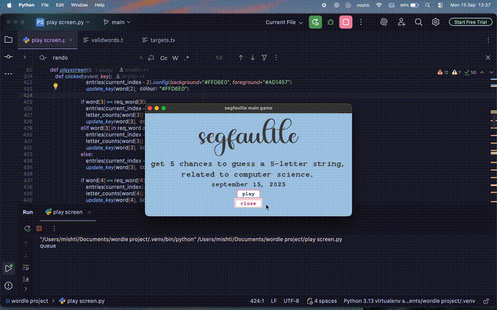

<a id="readme-top"></a>

<!-- PROJECT SHIELDS -->
<div align="center">

[![Stargazers][stars-shield]][stars-url]
[![Forks][forks-shield]][forks-url]
[![Issues][issues-shield]][issues-url]
[![MIT License][license-shield]][license-url]

</div>

<!-- PROJECT HEADER -->
<br />
<div align="center">

<h3 align="center">segfaultle</h3>

  <p align="center">
    ny times' wordle. except it's offline, pastel coded, and made by a 17 year old on a tight deadline.
    <br />
    <a href="https://github.com/mishtiiikrishnaa/segfaultle"><strong>explore the repo »</strong></a>
    <br />
    <br />
    <a href="https://github.com/mishtiiikrishnaa/segfaultle/issues/new?labels=bug">report bug</a>
    ·
    <a href="https://github.com/mishtiiikrishnaa/segfaultle/issues/new?labels=enhancement">request feature</a>
  </p>
</div>


<!-- TABLE OF CONTENTS -->
<details>
  <summary>table of contents</summary>
  <ol>
    <li>
      <a href="#about-the-project">about the project</a>
      <ul>
        <li><a href="#built-with">built with</a></li>
      </ul>
    </li>
    <li>
      <a href="#getting-started">getting started</a>
      <ul>
        <li><a href="#prerequisites">prerequisites</a></li>
        <li><a href="#installation">installation</a></li>
      </ul>
    </li>
    <li><a href="#usage">usage</a></li>
    <li><a href="#project-status">project status</a></li>
    <li><a href="#contributing">contributing</a></li>
    <li><a href="#license">license</a></li>
    <li><a href="#contact">contact</a></li>
    <li><a href="#acknowledgments">acknowledgments</a></li>
  </ol>
</details>


<!-- ABOUT THE PROJECT -->
## about the project

<div align="center">
  
  <br />
  <sub><a href="images/gameplay.mp4">watch the full recording</a></sub>
</div>

<br />

**segfaultle** is my wordle clone, a project i made in my senior year of high school for my finals. i took inspiration from the famous new york times' wordle game, then took away the internet and added a lot of pastel.

the name? it's wordle, but make it a segmentation fault. (python is far too polite to actually segfault.)

in my first semester of college i came back to it, modified it, and took **third place at an expo**. 🥉

here's what you get:

* a desktop game that runs entirely offline. no browser, no account, no wifi
* guess the secret string in 5 tries, with tiles that turn green, yellow or pink to tell you how close you were
* a pastel blue, lilac and butter-yellow colour scheme throughout
* an on-screen keyboard that recolours itself as you learn which letters are in play, plus full physical keyboard support (backspace included)
* a "how to play" screen so nobody has to guess the rules of a guessing game
* every secret word is a **computer science term** (think `stack`, `queue`, `regex`, `redis`, `html5`), picked at random from a list of 113 targets in `targets.txt`
* guesses are checked against a separate list of roughly 13,000 valid 5-letter words in `validwords.txt`, so you can fish around with ordinary words while the answer is secretly nerdy
* some targets contain digits (like `html5` or `php73`), so the tiles and the on-screen keyboard take numbers as well as letters
* play again straight after a win or a loss, and the game tells you the word if you lose

<p align="right">(<a href="#readme-top">back to top</a>)</p>


### built with

* [![Python][python-shield]][python-url]
* [![Tkinter][tkinter-shield]][tkinter-url]

<p align="right">(<a href="#readme-top">back to top</a>)</p>


<!-- GETTING STARTED -->
## getting started

to get a local copy up and running, follow these simple steps.

### prerequisites

* python 3. tkinter comes bundled with most python installs, but you can check with:
  ```sh
  python -m tkinter
  ```
  if a tiny test window pops up, you're all set.
* *(optional)* the **honey beauty** font. the headings use it, so install it for the full pastel effect. without it, tkinter quietly falls back to a default font.

### installation

1. clone the repo
   ```sh
   git clone https://github.com/mishtiiikrishnaa/segfaultle.git
   ```
2. move into the folder
   ```sh
   cd segfaultle
   ```
3. make sure `play screen.py`, `targets.txt` and `validwords.txt` are all sitting in the same folder, and **please don't rename any of them**. the game looks for those exact filenames.
4. run the game
   ```sh
   python "play screen.py"
   ```
   (the quotes are there because the filename has a space in it.)

no pip installs needed. everything used is part of python's standard library.

<p align="right">(<a href="#readme-top">back to top</a>)</p>


<!-- USAGE EXAMPLES -->
## usage

1. read the rules screen and press **ok** to start.
2. type a valid 5-letter word using your keyboard or the on-screen keys. the cursor hops to the next tile on its own.
3. once the fifth letter lands, the row is checked and the tiles change colour:

   | colour | meaning |
   | ------ | ------- |
   | 🟩 green `#A8E6CF` | the letter is in the word and in the correct spot |
   | 🟨 yellow `#FFF5A5` | the letter is in the word but in the wrong spot |
   | 🟪 pink `#FFD6E0` | the letter is not in the word in any spot |

4. the on-screen keyboard picks up the same colours, so you can see at a glance what you've already tried.
5. guess the word within 5 tries to win. hint: it's always a computer science term. if your guess isn't in the word list, you'll be told to try again.
6. when the round ends, choose whether to play another game.

### project files

```
segfaultle/
├── images/            # gameplay recording (gif + mp4) for this readme
├── play screen.py     # the whole game
├── targets.txt        # 113 computer science terms the game picks its secret word from
├── validwords.txt     # ~13,000 five-letter words accepted as guesses
├── LICENSE
└── README.md
```

### the palette

| use | hex |
| --- | --- |
| background | `#A7C7E7` |
| empty tiles | `#FDE2A2` |
| keyboard keys | `#CDB4DB` |
| key outline | `#8A6DB8` |
| correct | `#A8E6CF` |
| misplaced | `#FFF5A5` |
| absent | `#FFD6E0` |

<p align="right">(<a href="#readme-top">back to top</a>)</p>


<!-- PROJECT STATUS -->
## project status

**finished.** this was built as a high school finals project, then modified in my first semester of college, where it won third place at an expo. it did its job twice over, so there are no further updates planned.

what shipped:

- [x] offline play with local word lists
- [x] pastel tiles and a colour-reactive on-screen keyboard
- [x] physical keyboard support
- [x] rules screen and play-again prompt

it's a snapshot of where i was as a coder in my final year of school, quirks and all. if you want to take it somewhere new, forking is very welcome.

<p align="right">(<a href="#readme-top">back to top</a>)</p>


<!-- CONTRIBUTING -->
## contributing

since this project is finished, i'm not actively taking on new features, so the best way to build on it is to **fork it** and make it your own. if you spot a genuine bug, feel free to open an issue.

1. fork the project
2. create your feature branch (`git checkout -b feature/AmazingFeature`)
3. commit your changes (`git commit -m 'Add some AmazingFeature'`)
4. push to your branch (`git push origin feature/AmazingFeature`)

and if you enjoyed the game, a star is always lovely. thank you!

<p align="right">(<a href="#readme-top">back to top</a>)</p>


<!-- LICENSE -->
## license

distributed under the MIT license. see `LICENSE` for more information.

<p align="right">(<a href="#readme-top">back to top</a>)</p>

<!-- ACKNOWLEDGMENTS -->
## acknowledgments

* [the new york times' wordle](https://www.nytimes.com/games/wordle/index.html), the original and the inspiration
* [best-readme-template](https://github.com/othneildrew/Best-README-Template), the template this readme is built on
* [img shields](https://shields.io)
* [choose an open source license](https://choosealicense.com)
* [python's tkinter documentation](https://docs.python.org/3/library/tkinter.html)

<p align="right">(<a href="#readme-top">back to top</a>)</p>


<!-- MARKDOWN LINKS & IMAGES -->
[stars-shield]: https://img.shields.io/github/stars/mishtiiikrishnaa/segfaultle.svg?style=for-the-badge
[stars-url]: https://github.com/mishtiiikrishnaa/segfaultle/stargazers
[forks-shield]: https://img.shields.io/github/forks/mishtiiikrishnaa/segfaultle.svg?style=for-the-badge
[forks-url]: https://github.com/mishtiiikrishnaa/segfaultle/network/members
[issues-shield]: https://img.shields.io/github/issues/mishtiiikrishnaa/segfaultle.svg?style=for-the-badge
[issues-url]: https://github.com/mishtiiikrishnaa/segfaultle/issues
[license-shield]: https://img.shields.io/github/license/mishtiiikrishnaa/segfaultle.svg?style=for-the-badge
[license-url]: https://github.com/mishtiiikrishnaa/segfaultle/blob/main/LICENSE
[python-shield]: https://img.shields.io/badge/python-3776AB?style=for-the-badge&logo=python&logoColor=white
[python-url]: https://www.python.org/
[tkinter-shield]: https://img.shields.io/badge/tkinter-FFD43B?style=for-the-badge&logo=python&logoColor=black
[tkinter-url]: https://docs.python.org/3/library/tkinter.html